# Abstract

This project applies the full Applied Data Science (ADS) syllabus — the data science process, descriptive statistics, multivariate exploration, inferential statistics, regression, anomaly detection and time-series analysis — to a real dataset of 50,411 country-year observations: the Our World in Data (OWID) CO₂ and Greenhouse Gas Emissions dataset (79 variables, 1750–2024). After separating 219 countries from regional aggregates to avoid double counting, we find that world fossil and industry CO₂ emissions reached a record 38.6 Gt in 2024, 70% above 1990, and that three countries emit 53% of the total. Emissions per person are extremely unequal and right-skewed (mean 4.63 t, median 3.21 t, kurtosis β₂ = 14.1), and close to log-normal. Continents differ significantly (one-way ANOVA F = 30.9, p < 0.001), and the average country's per-person emissions fell between 2005 and 2024 (paired t = -2.86, p = 0.005). Across countries, log GDP per person and log CO₂ per person are strongly correlated (r = 0.907). Adding energy use per person raises R² to 0.951, and GDP then becomes non-significant: the relationship runs through energy use. All 53 implemented concepts are validated against the course's worked examples and independent library implementations in an automated test suite, and are presented in an interactive Streamlit dashboard.

# 1. Introduction

## 1.1 Motivation

Carbon dioxide from burning fossil fuels and making cement is the main driver of human-caused climate change. Who emits, how much, and how that is changing are central questions in climate policy. They are also a good test bed for data science: the data are large, messy (countries mixed with regional totals, uneven historical coverage), heavily skewed, and easy to misread. The best-known trap is confusing total emissions with emissions per person.

The ADS course taught each technique on small classroom examples of 4 to 15 observations. The aim of this project is to show how the same concepts behave on a real dataset with tens of thousands of observations, where data preparation decisions matter and assumptions can fail.

## 1.2 Objectives

1. Build a reproducible pipeline that preserves the raw data and produces analysis-ready country data.
2. Implement every applicable syllabus concept with the course's own formulas, apply it to real variables, and validate it.
3. Answer a focused set of research questions with computed evidence, separating description from causation.
4. Present the analysis in an interactive dashboard with an "ADS Concepts Lab" linking each concept to its formula, result and code.

## 1.3 Research questions

1. How have global CO₂ emissions changed over time?
2. Which countries contribute the largest shares of emissions?
3. How do total emissions differ from emissions per person?
4. Which countries changed most between 2005 and 2024, in absolute and percentage terms?
5. How are per-person emissions distributed across countries?
6. Which countries are unusual under clearly defined statistical criteria?
7. How are emissions related to GDP and energy use?
8. Do continents differ, and has the average country changed significantly?
9. How sensitive are the findings to the choice of measure, period and method?

# 2. Dataset

## 2.1 Source and provenance

The primary dataset is the OWID *CO₂ and Greenhouse Gas Emissions* dataset (catalog.ourworldindata.org/emissions/owid_co2), built mainly from the Global Carbon Project's Global Carbon Budget, with population, GDP (Maddison Project, international-$ at 2011 prices) and energy (Energy Institute) series. It is licensed CC BY 4.0. The file was downloaded on 21 October 2026 (server revision of 30 September 2026). Its SHA-256 hash is stored in `data/raw/MANIFEST.json` and re-checked every time the pipeline runs, because OWID revises the file regularly.

One supplementary file was added: OWID's country-to-continent lookup, used only to form groups for the t-test and ANOVA.

## 2.2 Structure

| Property | Value |
|---|---|
| Rows × columns | 50,411 × 79 (77 numeric, 2 text) |
| Years | 1750–2024 |
| Entities | 254, of which 219 are countries |
| Unique key | (country, year): 0 duplicates, 0 duplicate rows |
| GDP coverage | ends in 2022 |
| Energy coverage | starts in 1965 |

The variables used most are annual CO₂ (`co2`, million tonnes), CO₂ per person (`co2_per_capita`, tonnes), cumulative CO₂, CO₂ by fuel (coal, oil, gas, cement, flaring, other), population, GDP and primary energy per person (kWh).

**Levels of measurement (Module 2.1).** `country`, `iso_code` and `continent` are nominal; `year` and growth rates are interval (no true zero, can be negative); emissions, population, GDP and per-person measures are ratio variables, so means, ratios and coefficients of variation are meaningful for them.

# 3. Methodology

## 3.1 Process

The project follows the course's data science process (CRISP-DM): prior knowledge and research questions → data preparation → modelling → evaluation → application (dashboard) → knowledge (findings). The code mirrors this: `data.py` and `quality.py` (preparation), `descriptive.py`, `correlation.py`, `inference.py`, `regression.py`, `lof.py`, `timeseries.py` (analysis, one module per syllabus unit), `results.py` (application to the dataset) and a Streamlit app (presentation).

## 3.2 Data preparation

The pipeline keeps three layers: **raw** (never modified), **clean** (every raw row, plus derived columns and flags) and **analysis-ready** (country-only cross-sections and series built for each analysis).

**Countries vs aggregates.** 36 entities have no ISO code: continents, income groups, a second set of "(GCP)" regions, the EU, international aviation and shipping, the 1991 Kuwaiti oil fires and the historical Ryukyu Islands. All are aggregates or special sources except Kosovo, which is a country. Summing aggregates with countries would double-count, so every analysis filters `entity_type = country`. As a check, the World total equals the sum of countries plus international aviation and shipping to within 0.5% in every test year.

**Missing values.** Missingness ranges from 0% to over 95% depending on the column. A blank means "not reported", never zero emissions, so nothing is imputed and rows are never dropped globally. Each analysis removes missing values only for the columns it uses and reports its own n.

**Invalid values and outliers.** No non-negative column contains a negative value (0). Negative land-use or growth values are legitimate (carbon sinks, falling emissions). Of 640 zero-emission country-years, 578 are before 1950 (years before a country's record starts). Fuel components add up to the total to within 1.44 Mt. Extreme values such as Qatar's are flagged but kept, because they are plausible real values.

**Transformations.** GDP per person = GDP / population. Per-person CO₂, GDP and energy are strongly right-skewed, so tests and regressions use log₁₀ values. LOF uses min–max normalisation so neither variable dominates the distance.

**Analysis years.** Emissions use 2024 (latest). Anything involving GDP uses 2022 (the last GDP year). Change comparisons use 2005 as the base year.

## 3.3 Tools and validation

Python 3.12 with pandas, NumPy and SciPy (for critical values and p-values, i.e. the "tables"), Plotly and Streamlit; statsmodels and scikit-learn are used only as independent cross-checks. All formulas are written by hand following the course formula sheet, for example quartiles at the k(N+1)/4 position and multiple regression from deviation sums. An automated test suite of 56 tests checks that:

- every formula reproduces the worked examples in the course slides (one-sample, independent and paired t-tests, z-test, confidence intervals, one-way ANOVA, multiple regression, simple regression, LOF, additive and multiplicative decomposition, forecast error measures, Poisson, and the Module 2 discrete-series, grouped-quartile, open-end-class, corrected-mean and cumulative-frequency examples);
- every formula agrees with an independent library implementation (NumPy, SciPy, statsmodels, scikit-learn);
- the raw file hash, shape, key uniqueness, entity classification and World reconciliation are correct;
- every dashboard page renders.

Random processes (CLT, bootstrap, cross-validation, error simulation) use a fixed seed (42).

# 4. Exploratory and descriptive analysis

## 4.1 Global trend (RQ1)

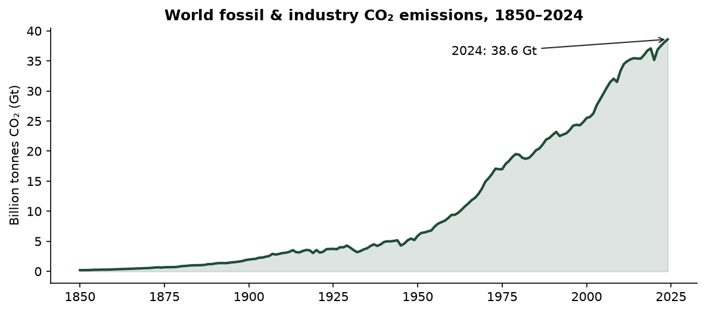

World emissions were 5.9 Gt in 1950 and 38.6 Gt in 2024, 6.5 times higher. The 2024 value is the highest on record and 70% above 1990. Emissions fell in only a few years, all tied to known shocks: the oil crises (1974–75, 1980–82), the post-Soviet collapse (1992), the financial crisis (2009) and COVID-19 (2020, -5.2%), followed by a 4.9% rebound in 2021. World emissions per person were 4.73 t in 2024.

## 4.2 Who emits (RQ2, RQ3)

| Country | CO₂ (Mt) | % of world | Rank (total) | t / person | Rank (per person) |
|---|---:|---:|---|---:|---|
| China | 12,289 | 31.8 | 1 | 8.66 | 30 |
| United States | 4,904 | 12.7 | 2 | 14.20 | 12 |
| India | 3,193 | 8.3 | 3 | 2.20 | 130 |
| Russia | 1,781 | 4.6 | 4 | 12.29 | 19 |
| Japan | 962 | 2.5 | 5 | 7.77 | 36 |
| Indonesia | 812 | 2.1 | 6 | 2.87 | 115 |
| Iran | 793 | 2.1 | 7 | 8.66 | 31 |
| Saudi Arabia | 692 | 1.8 | 8 | 20.38 | 6 |
| South Korea | 584 | 1.5 | 9 | 11.29 | 21 |
| Germany | 572 | 1.5 | 10 | 6.77 | 43 |

*Table 1: Top ten emitters in 2024.*

The top three countries emit 52.8% of world CO₂ and the top ten 68.9%. Rankings change completely when measured per person. India is the #3 emitter in total but #130 per person (2.20 t). The United States is #2 in total and #12 per person (14.2 t). Historically (cumulative emissions since 1750) the United States is responsible for 23.5% and China for 15.4%. Any comparison must therefore state whether it is about total, per-person or cumulative emissions.

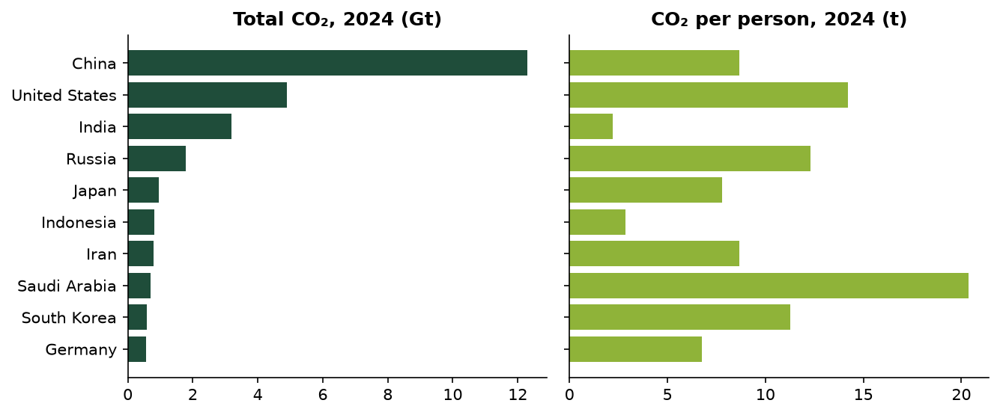

## 4.3 Change since 2005 (RQ4)

Of 215 countries with data in both years, 62 emit less in 2024 than in 2005 and 152 emit more. China added 6,407 Mt, more than every other country's increase combined, followed by India (1,998 Mt). Percentage changes are computed only for the 95 countries emitting at least 10 Mt in 2005, because tiny bases produce meaningless percentages. The largest falls were Ukraine (-55%), Yemen (-54%), Greece (-53%), Estonia (-51%), Portugal (-49%), mostly European. The largest rises were Vietnam (+287%), Bangladesh (+187%), Myanmar (+174%).

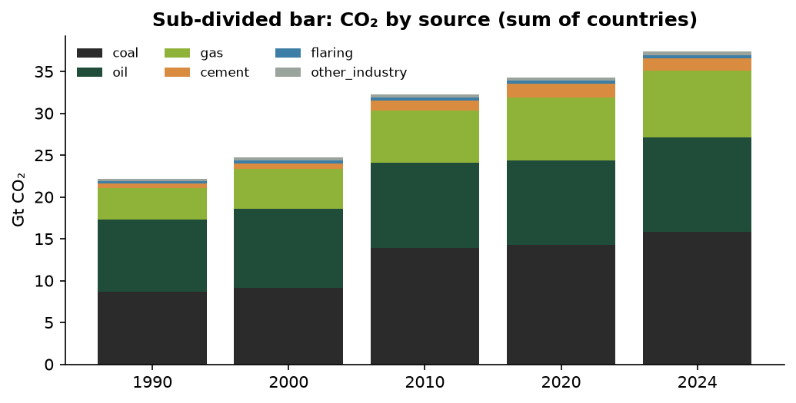

## 4.4 Distribution of per-person emissions (RQ5)

All measures below follow the course formula sheet and use the 214 countries with per-person data in 2024.

| Measure | Formula | Value |
|---|---|---:|
| Mean | ΣX / N | 4.632 |
| Median | (N+1)/2 th item | 3.210 |
| Mode (grouped) | L + Δ₁/(Δ₁+Δ₂)·i | 2.053 |
| Q1 / Q3 | (N+1)/4, 3(N+1)/4 th item | 0.985 / 6.019 |
| D1 / D9 | k(N+1)/10 th item | 0.275 / 11.183 |
| Range; coefficient of range | L − S; (L−S)/(L+S) | 41.217; 0.997 |
| IQR; quartile deviation; coeff. of QD | Q3−Q1; (Q3−Q1)/2; (Q3−Q1)/(Q3+Q1) | 5.034; 2.517; 0.719 |
| Standard deviation σ (÷N); s (÷(n−1)) | √[Σ(X−X̄)²/N] | 5.501; 5.513 |
| Coefficient of variation | σ/X̄ × 100 | 118.7% |
| Karl Pearson skewness | (X̄ − Mode)/σ; 3(X̄ − Med)/σ | 0.469; 0.776 |
| Bowley skewness | (Q3+Q1−2Med)/(Q3−Q1) | 0.116 |
| Kurtosis β₂ | μ₄/μ₂² | 14.11 |

*Table 2: Descriptive statistics of CO₂ per person (t), 2024.*

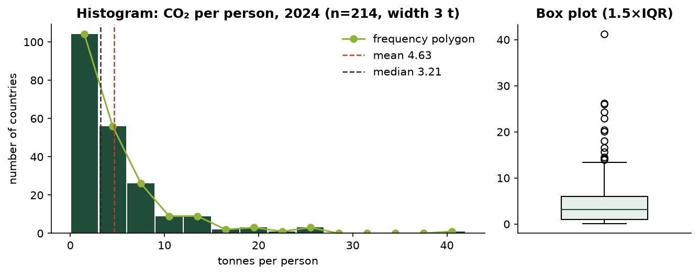

The distribution is strongly **positively skewed**: Mode (2.05) < Median (3.21) < Mean (4.63), the order the course gives for right skew. The coefficient of variation exceeds 100%, and β₂ = 14.1 (well above 3) shows a leptokurtic shape: a sharp peak of low emitters with a heavy upper tail. Bowley's coefficient (0.116) is much smaller than Pearson's (0.776) because it only uses the middle 50% and ignores the tail. Note: the course formula sheet's kurtosis table pairs the shape descriptions with the wrong β₂ values; the standard meaning (β₂ > 3 = more peaked, heavier tails) is used here.

**Grouped-data estimates.** With 14 classes of width 3 t (≈ √n rule), the grouped mean is 4.907 by both the direct and step-deviation methods (assumed mean A = 1.5), the grouped median is 3.161 and the grouped σ is 5.336. They differ from the exact values because grouping assumes values sit at class mid-points (mean, σ) or spread evenly through each class (median, quantiles):

| Measure | Raw data | Grouped data | Grouped − raw | Difference % |
|---|---:|---:|---:|---:|
| Mean | 4.632 | 4.907 | 0.274 | 5.9 |
| Median | 3.210 | 3.161 | -0.049 | -1.5 |
| Mode | — | 2.053 | — | — |
| Q1 | 0.985 | 1.543 | 0.558 | 56.6 |
| Q3 | 6.019 | 6.058 | 0.038 | 0.6 |
| IQR | 5.034 | 4.514 | -0.519 | -10.3 |
| D1 | 0.275 | 0.617 | 0.343 | 124.8 |
| D9 | 11.183 | 11.200 | 0.017 | 0.2 |
| Standard deviation σ | 5.501 | 5.336 | -0.164 | -3.0 |

The lower quantiles are worst, because 104 of 214 countries fall in the first class and are spread unevenly inside it. This is the cost of grouping when the raw data are available.

**Weighted vs simple mean.** The simple mean (4.632 t) describes the typical *country*. The population-weighted mean ΣWX/ΣW (4.587 t) describes the typical *person*. The World figure (4.729 t) is slightly higher again. The countries emit 37,406 Mt for 8.154 bn people; adding international aviation and shipping (1,192 Mt), which belong to no country, gives 4.734 t, and the World row's slightly larger population (8.162 bn) brings it to 4.729 t. The combined mean of the six continent means, weighted by group size, reproduces the overall mean exactly (4.632).

## 4.5 Outliers (RQ6, part 1)

With the box-plot rule, the limits are Q1 − 1.5·IQR = -6.57 and Q3 + 1.5·IQR = 13.57. 13 countries are high outliers: Qatar, Kuwait, Brunei, Bahrain, Trinidad and Tobago, Saudi Arabia, United Arab Emirates, New Caledonia, Sint Maarten (Dutch part), Oman, Australia, United States, Kazakhstan. Most are oil- and gas-exporting states, several with small populations (Qatar, Kuwait, Brunei, Bahrain); the rest are large fossil-fuel producers or energy-intensive economies (Saudi Arabia, Kazakhstan, Australia, the United States). They are genuine values and are kept; medians, IQR and log scales limit their influence.

## 4.6 Classification, tabulation and diagrams

The course names four types of classification; each was applied to the 2024 country data (214 countries with a continent).

- **Geographical (area-wise).** By continent: Asia's 50 countries emit 60.6% of world CO₂, North America 15.8%, Europe 12.6%, Africa 3.9%. Per person, North America (9.99 t) is ten times Africa (0.99 t).
- **Chronological (time-wise).** World emissions by decade: mean annual CO₂ rose from 7.3 Gt in the 1950s to 35.4 Gt in the 2010s and 37.2 Gt in 2020–2024. Growth slowed from over 50% per decade in the 1960s–70s to 5% in the latest period.
- **Qualitative (by attribute).** Two-fold: 62 countries emit less than in 2005 and 152 the same or more. Manifold: continent → fell or rose → largest reported fuel source (oil is the largest source in most countries, coal in most of the biggest Asian emitters).
- **Quantitative (by magnitude).** Classes of CO₂ per person (Table 3a).

| Continent | < 1 t | 1–3 t | 3–6 t | 6–10 t | 10 t + | Total |
|---|---|---|---|---|---|---|
| Africa | 38 | 11 | 4 | 2 | 0 | 55 |
| Asia | 9 | 13 | 11 | 5 | 12 | 50 |
| Europe | 0 | 2 | 25 | 14 | 3 | 44 |
| North America | 2 | 12 | 6 | 7 | 7 | 34 |
| Oceania | 4 | 6 | 5 | 1 | 3 | 19 |
| South America | 0 | 7 | 5 | 0 | 0 | 12 |
| Total | 53 | 51 | 56 | 29 | 25 | 214 |

*Table 3a: Two-way table, continent × CO₂ per person (2024). The Total row is the simple (one-way) table; adding "fell or rose since 2005" as a third characteristic gives the higher-order table in the dashboard.*

Diagrams were chosen by question. One-dimensional bars cover rankings (simple), comparisons across years (multiple), composition (sub-divided and percentage), change (deviation) and one extreme value (broken bar). Two-dimensional diagrams are used where area should carry the value: squares (side = √value), circles (r = √(value/π)), pie, and a rectangular diagram whose width is population, height is CO₂ per person, and area is therefore total CO₂. That one figure shows all three measures of RQ3 at once.

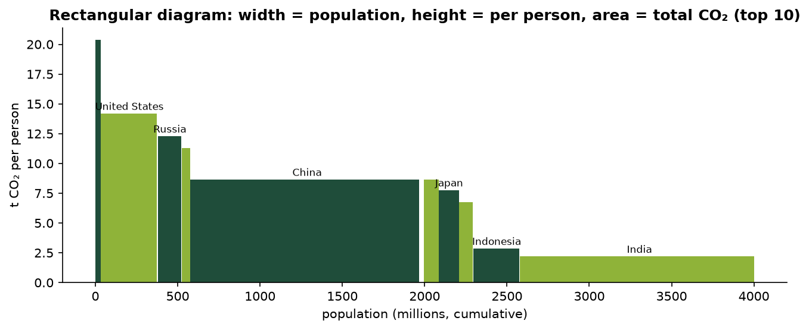

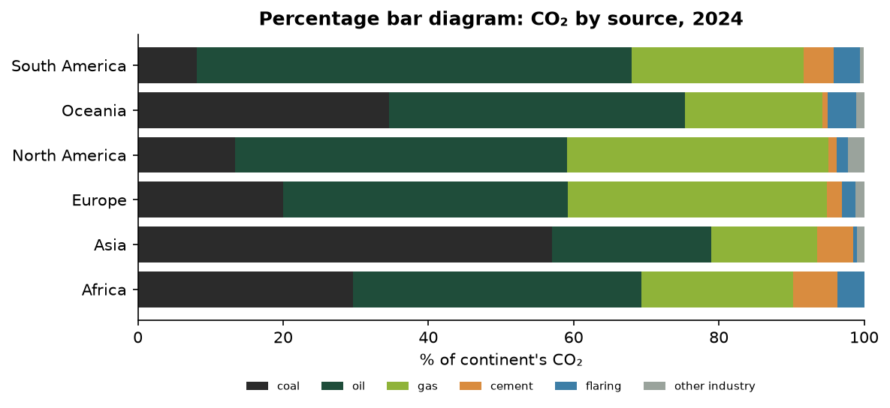

The percentage bars show that coal is 57% of Asia's emissions against 20% of Europe's: composition differs as much as size. Line graphs use a zero baseline by default; the dashboard also shows a false baseline (marked break), which reveals the 2009 and 2020 dips but exaggerates change.

## 4.7 Further univariate methods

**Discrete series.** A naturally discrete variable was built from the data: for each of 214 countries, years with falling CO₂, 2006–2024. Discrete-series formulas give mean ΣfX/N = 7.168 (short-cut method: 7.168), median = the X whose cf first reaches (N+1)/2 = 7, mode = 6, Q1 = 5, Q3 = 10 and σ = 3.370 (actual-mean and assumed-mean methods agree). Unlike per-person emissions, this count is close to symmetric. Grouped into inclusive classes 0–3, 4–7, …, the classes were converted to exclusive form (−0.5 / +0.5) before applying the interpolation formula (grouped median 6.652).

**Cumulative frequency and ogive.** The "less than" and "more than" ogives of CO₂ per person cross at N/2, giving a graphical median of 3.1607 t, identical to the formula L + (N/2 − cf)/f × i (3.1607). Quartiles read from the ogive are 1.543 and 6.058 t.

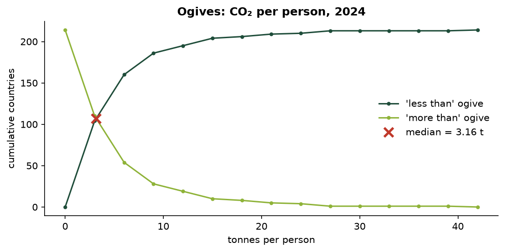

**Open-end classes.** With the last class written as "15 t and above", the course rule (assume the neighbour's width) gives a mean of 4.598 t, against 4.907 t with all classes closed and 4.632 t exactly. The median (3.161 t) does not depend on the open limit, which is why the course recommends the median for open-ended, skewed distributions.

**Correcting incorrect items.** If the 17 aggregate rows (regions, income groups, World) were averaged in with the countries by mistake, the per-person mean would be 4.6981 t. The course correction ΣX = N·X̄ − ΣX_wrong, with N reduced accordingly, recovers 4.6325 t, exactly the countries-only mean. This is a concrete demonstration of why separating aggregates matters.

**Moments.** Central moments μ₂ = 30.26, μ₃ = 462.4, μ₄ = 12,918 (identical whether computed directly or from moments about the origin), giving β₁ = 7.719 and β₂ = 14.11. Pearson's empirical relation Mode ≈ 3·Median − 2·Mean gives 0.365, far from the grouped mode (2.053). The relation assumes moderate skew, and its failure is another sign of how skewed the data are.

# 5. Multivariate exploration

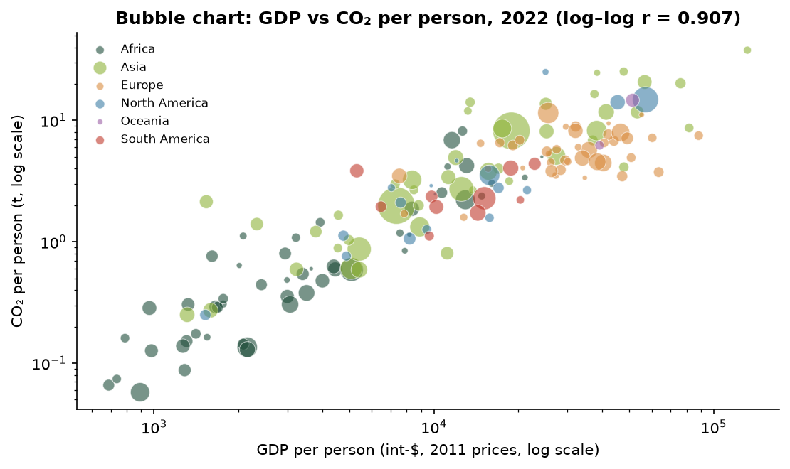

For 164 countries in 2022, the central data point (Module 2.4) is (GDP per person = 19,149 int-$, CO₂ per person = 4.53 t). The countries farthest from it are Qatar, United Arab Emirates, Kuwait.

| Pair | n | Pearson r | Degree | r² | Probable error |
|---|---:|---:|---|---:|---:|
| GDP pc vs CO₂ pc (raw) | 164 | 0.745 | Moderate degree positive | 0.556 | 0.0234 |
| log GDP pc vs log CO₂ pc | 164 | 0.907 | High degree positive | 0.823 | 0.0093 |
| log energy pc vs log CO₂ pc | 164 | 0.974 | High degree positive | 0.950 | 0.0027 |

*Table 3: Karl Pearson correlation coefficients (2022).*

All three course methods (actual-mean deviations, direct method and assumed-mean deviations) give identical r, and |r| > 6 × probable error in every case. The relationship is stronger on log scales because both variables are skewed and the relationship is multiplicative. Population is barely correlated with emissions per person (log r = -0.11) but strongly with total emissions. **Correlation is not causation:** richer countries use more energy, most of it fossil, but the energy mix differs widely. Sweden and Germany have almost the same GDP per person, yet Sweden emits less than half as much CO₂ per person while using more energy per person, thanks to hydro and nuclear power.

**Types of correlation.** By direction and shape: positive (log GDP vs log CO₂ per person, r = 0.907); negative across countries (log GDP vs log CO₂ per kWh of energy, r = -0.461: richer countries have a cleaner energy mix); negative over time (UK emissions vs year 1990–2024, r = -0.931); none (population vs CO₂ per person, r = -0.002); and non-linear (raw GDP vs raw CO₂ per person, where the curved pattern gives a lower r of 0.745). By number of variables: the simple correlations of log CO₂ per person with log GDP (0.907) and log energy (0.974) are both high, but the **partial** correlation with GDP holding energy constant is only -0.151, while energy holding GDP constant keeps 0.850. The **multiple** correlation R = 0.975 equals the square root of the regression R² in Section 7.

# 6. Inferential statistics

## 6.1 Normal distribution and the central limit theorem

| Range | Normal | Observed (raw) | Observed (log₁₀) |
|---|---:|---:|---:|
| μ ± 1σ | 68.3% | 88.8% | 70.1% |
| μ ± 2σ | 95.4% | 95.3% | 93.9% |
| μ ± 3σ | 99.7% | 97.7% | 100.0% |

*Table 4: Empirical-rule check for CO₂ per person, 2024.*

Raw per-person emissions break the 68–95–99.7 rule (too many values within 1σ, too few within 3σ). Their logarithms follow it closely, and the kurtosis of the logs is β₂ = 2.82, close to the normal value of 3. The variable is therefore approximately **log-normal**, although the logs keep a mild left skew (Bowley -0.31) from the very lowest emitters. This justifies using the log scale for tests and regression.

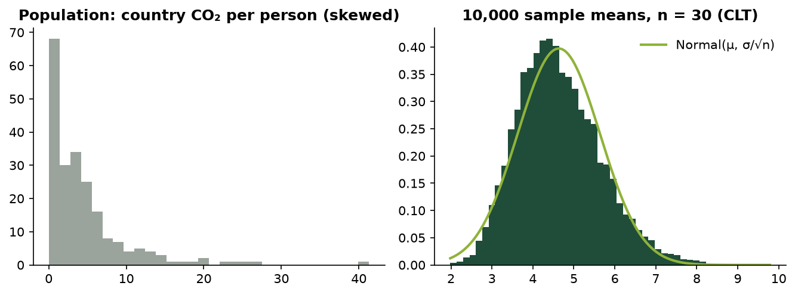

**CLT.** Treating the 214 countries as a population, 10,000 random samples of n = 30 were drawn. The sample means average 4.640 (population mean 4.632) with standard deviation 1.018, matching the theoretical σ/√n = 1.004. Skewness drops from 0.78 to 0.30: the sampling distribution of the mean is close to normal even though the data are not.

## 6.2 Confidence intervals

The 95% z-interval (n ≥ 30) for mean CO₂ per person in 2024 is 4.632 ± 1.96 × 5.513/√214 = **(3.894, 5.371)** t. A percentile bootstrap (Module 1, 5,000 resamples) gives a 95% interval for the *median* of (2.538, 3.733) t. Since the countries are nearly the whole population rather than a random sample, these intervals are interpreted in a super-population sense: uncertainty about the process that generates national emissions.

## 6.3 Hypothesis tests

| Test | H₀ | Statistic | Critical (5%) | p-value | Decision |
|---|---|---:|---:|---:|---|
| z, single mean | μ = world per-person value (4.729 t) | Z = -0.256 | ±1.96 | 0.798 | Fail to reject H0 |
| Paired t (2005 vs 2024, n = 214) | μ_d = 0 | t = -2.864 | ±1.971 | 0.0046 | Reject H0 |
| Independent t, log₁₀ (Europe n=44 vs Asia n=50) | μ₁ = μ₂ | t = 1.752 | ±1.986 | 0.083 | Fail to reject H0 |

*Table 5: z and t tests on CO₂ per person.*

- **Paired t-test.** Mean per-person emissions of the same 214 countries fell from 5.279 t to 4.632 t (d̄ = -0.647), which is significant at 5%. Yet 127 countries rose and only 87 fell: large reductions in high-emitting countries outweigh many small increases. The mean and the count tell different stories.
- **Independent t-test.** Europe's geometric-mean emissions (5.03 t) exceed Asia's (3.54 t), but the difference is not significant at 5%. The variance ratio is 9.3, which violates the pooled-variance assumption, so Welch's test is also reported (p = 0.070). It leads to the same conclusion.
- **z-test.** The average country is not significantly different from the average person's value, partly because country values are so dispersed.

## 6.4 Analysis of variance

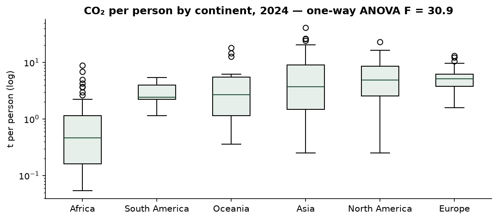

| Source | SS | d.f. | MS | F |
|---|---:|---:|---:|---:|
| Between groups | 32.855 | 5 | 6.571 | 30.87 |
| Within groups | 44.277 | 208 | 0.213 | — |
| Total | 77.131 | 213 | — | — |

*Table 6: One-way ANOVA, log₁₀ CO₂ per person by continent (2024).*

F = 30.87 far exceeds the 5% critical value F(5, 208) = 2.26 (p = 0.0e+00), so mean log emissions per person differ between continents. η² = 0.426: continent accounts for 43% of the variation. **Correction to the course method:** the slides compute the grand mean as the mean of the sample means. That is correct only when all groups are the same size. Here the groups range from 12 to 55 countries, so the grand mean of all observations (0.3567) is used, not the mean of means (0.4037). With this choice SS_total = SS_between + SS_within holds exactly. Europe has a much smaller spread than Africa, so the equal-variance assumption is only approximate.

**Two-way ANOVA (without replication)** on continental per-person emissions (rows: 6 continents; columns: 1990, 2000, 2010, 2020, 2024):

| Source | SS | d.f. | MS | F | F crit (5%) |
|---|---:|---:|---:|---:|---:|
| Between columns (year) | 10.335 | 4 | 2.584 | 1.36 | 2.87 |
| Between rows (continent) | 571.261 | 5 | 114.252 | 60.13 | 2.71 |
| Residual | 38.001 | 20 | 1.900 | — | — |
| Total | 619.597 | 29 | — | — | — |

*Table 7: Two-way ANOVA, continent × year.*

The continent effect is significant (Reject H0); the year effect is not (Fail to reject H0). This is not because nothing changed: Asia rose from 2.05 to 4.87 t while Europe fell from 11.12 to 6.54 t. Opposite movements cancel in the column totals and end up in the residual (a continent × year interaction, which a design without replication cannot test).

## 6.5 Type I and Type II errors

Repeatedly sampling n = 40 countries and testing the true mean at α = 0.05 gave a Type I error rate of 0.090, above the nominal 0.05: with heavily skewed data the normal approximation is not yet accurate at this sample size. Testing a mean that is wrong by 1.5 t gave a Type II error rate β = 0.511 (power 0.489). Increasing n is the only way to reduce both errors together, as the course notes state.

## 6.6 Poisson distribution

The yearly number of countries (emitting ≥ 1 Mt) whose emissions fell by more than 10% was tested as a candidate Poisson count, 1991–2024. A Poisson variable has mean = variance. Here the mean is 11.97 and the variance 65.42 (dispersion index 5.47, χ² test p = 0.0e+00). **The Poisson model is rejected**: sharp drops cluster in global crisis years (42 countries in 2020, 27 in 2009) instead of occurring independently at a constant rate. The Poisson formula itself is implemented and checked against the course example (P(X ≤ 2 | μ = 4) = 0.238).

# 7. Regression analysis

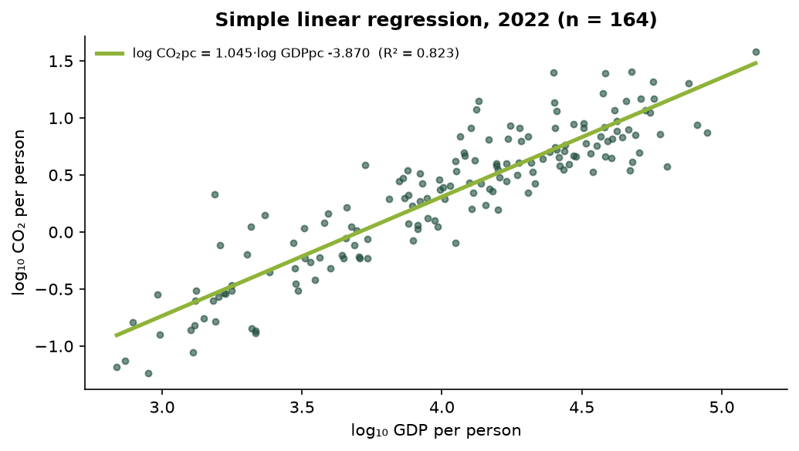

**Simple regression** of log₁₀ CO₂ per person on log₁₀ GDP per person (2022, n = 164), with slope a = (nΣxy − ΣxΣy)/(nΣx² − (Σx)²) and intercept b = (Σy − aΣx)/n:

log₁₀ CO₂pc = 1.0447 · log₁₀ GDPpc -3.8696,   R² = 0.823,   t(slope) = 27.4.

On log–log scales the slope is an elasticity: across countries, 1% higher GDP per person goes with about 1.04% higher CO₂ per person.

**Multiple regression** adds X₂ = log₁₀ energy per person, with coefficients from the course's deviation-sum formulas:

log₁₀ CO₂pc = -3.1686 -0.1167 · log₁₀ GDPpc +0.9864 · log₁₀ Energy pc

| Statistic | Value |
|---|---:|
| R² / adjusted R² | 0.9508 / 0.9501 |
| F (2, 161) | 1,554.2 (critical 3.05) |
| b₁ (GDP): t, p | -1.938, 0.054 |
| b₂ (energy): t, p | 20.47, 0.0e+00 |
| r₁₂ between predictors | 0.942 |
| MAE / RMSE (log₁₀ scale) | 0.094 / 0.135 |
| MAPE after back-transforming to tonnes | 23.7% (simple model: 49.0%) |

*Table 8: Multiple regression results (2022).*

Following the course procedure, the overall F-test is applied first. It rejects H₀ (b₁ = b₂ = 0), so the individual coefficients are then tested. Energy per person is highly significant. GDP becomes **not significant** (p = 0.054), and its sign even turns slightly negative. The reason is **multicollinearity**: GDP and energy per person are correlated at r₁₂ = 0.94, so the model cannot separate their effects. The economic reading is that income is associated with emissions mainly *through* energy use. Energy and CO₂ are also partly the same quantity, since most energy is fossil, so the high R² is partly by construction and is not evidence of a causal mechanism.

**Model evaluation (Module 1).** On a 2/3 : 1/3 hold-out split (109 / 55 countries), test R² = 0.938. With 5-fold cross-validation, mean validation R² = 0.946 for the multiple model and 0.803 for the simple model. Validation scores are close to the in-sample ones, so neither model overfits. MAPE is reported after back-transforming to tonnes, because on the log scale values near zero make MAPE meaningless (a limitation the slides note).

# 8. Anomaly detection: Local Outlier Factor (RQ6, part 2)

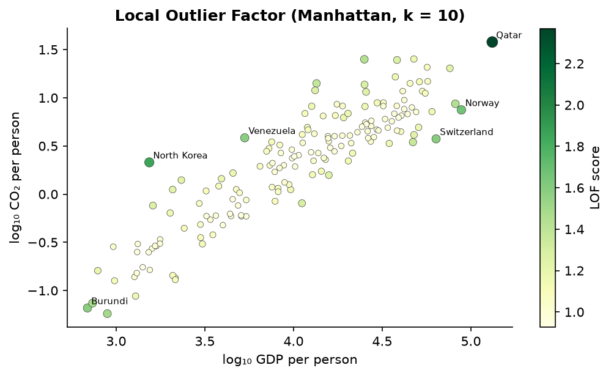

LOF was implemented step by step as in Module 5: Manhattan distance → k-distance and k-neighbourhood → reachability distance max(k-dist(o), d(p,o)) → local reachability density → LOF = average neighbour lrd / own lrd. It was applied to min–max scaled log GDP and log CO₂ per person (2022, n = 164, k = 10). 6 countries have LOF > 1.5:

| Country | Continent | GDP pc ($) | CO₂ pc (t) | LOF |
|---|---|---:|---:|---:|
| Qatar | Asia | 131,991 | 37.89 | 2.370 |
| North Korea | Asia | 1,538 | 2.14 | 1.855 |
| Norway | Europe | 88,390 | 7.48 | 1.670 |
| Switzerland | Europe | 63,623 | 3.75 | 1.592 |
| Venezuela | South America | 5,305 | 3.84 | 1.586 |
| Burundi | Africa | 689 | 0.07 | 1.583 |
| Democratic Republic of Congo | Africa | 892 | 0.06 | 1.494 |
| Central African Republic | Africa | 736 | 0.07 | 1.488 |

*Table 9: Highest LOF scores.*

Unlike the one-dimensional IQR rule, which flagged only high emitters, LOF is local and two-dimensional. It flags Qatar (extreme on both axes), but also countries whose emissions are unusual *for their income*: rich low-carbon economies (Norway, Switzerland, Sweden, Singapore), very poor countries with almost no fossil-fuel use (Burundi, DR Congo), and North Korea (high CO₂ for its very low recorded GDP). Of LOF's top ten, only Qatar, Trinidad and Tobago were also IQR outliers. The two methods answer different questions.

# 9. Time-series analysis

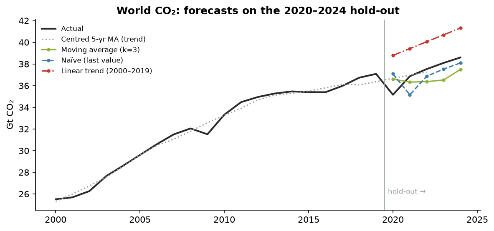

**Decomposition.** Classical decomposition (Y = T + S + R or T × S × R) requires a seasonal pattern within each year. OWID data are annual, so no seasonal component exists. The method is implemented and verified on the course's quarterly-sales example (indices −10.44, −11.69, 6.06, 16.06; forecasts 23.31 and 43.56), and only its trend step, a centred 5-year moving average, is applied to world CO₂.

**Forecasting.** World emissions 1950–2019 form the training period and 2020–2024 the hold-out. Average, moving-average (k = 3) and naïve forecasts are one-step-ahead, using actual values up to the previous year as in the slides. The least-squares trend is fitted on 2000–2019 and extrapolated. MASE scales MAE by the in-sample naïve error of the training period.

| Method | MAE (Mt) | RMSE (Mt) | MAPE (%) | MASE |
|---|---:|---:|---:|---:|
| Average method | 16,286 | 16,311 | 43.69 | 31.52 |
| Moving average (k=3) | 1,163 | 1,217 | 3.13 | 2.25 |
| Naïve (last value) | 1,074 | 1,237 | 2.93 | 2.08 |
| Linear trend (2000–2019) | 2,805 | 2,836 | 7.57 | 5.43 |

*Table 10: Forecast accuracy on 2020–2024.*

The average method is useless for a trending series (44% error), exactly as the slides warn: old values never leave the average. The 2000–2019 trend line (slope 632 Mt per year, R² = 0.950) overshoots because growth slowed after about 2013 and 2020 fell sharply. The best method by MASE was **Naïve (last value)**. All MASE values exceed 1, so over these five volatile years no method beat simply carrying last year's value forward. Fitting the trend on 2000–2024 gives a slope of 526 Mt per year. Mechanically extended to 2030 that implies about 42.6 Gt, but this is an extrapolation, not a prediction: it ignores policy and technology change.

# 10. Validation and academic integrity

- **Formula correctness:** each implementation reproduces the course worked examples to the printed precision. The one discrepancy (independent t = 0.610 vs 0.609 on the slide) comes from the slide rounding an intermediate value.
- **Independent cross-checks:** quantiles (NumPy), moments and kurtosis (SciPy), t-tests and one-way ANOVA (SciPy), two-way ANOVA and regression including standard errors (statsmodels), LOF (scikit-learn).
- **Data integrity:** raw file hash, 50,411 × 79 shape, unique keys, entity classification, World reconciliation, and no imputed values (tests in `tests/test_data.py`).
- **Consistency:** the dashboard, this report, the slides and the viva guide all read numbers from the same `results.py` code, so tables, charts and text cannot disagree.
- **Errors in course material found and handled:** kurtosis shape labels swapped on the formula sheet; ANOVA grand mean as an unweighted mean of means; the Module 4 slide on b₂ reuses b₁'s numbers; the Module 2 "median from cumulative data" example uses i = 10 for classes 5 wide and prints 14.29 instead of 12.15.

# 11. Discussion and limitations

- **Measures matter.** Total, per-person, cumulative and consumption-based emissions rank countries very differently. The simple mean across countries (one vote per country) differs from the population-weighted mean (one vote per person).
- **Coverage.** About 5 countries are reported in 1750, about 175 in 1950 and 216 from 2000. GDP ends in 2022, and consumption-based emissions start in 1990 for about 120 countries. Long-run comparisons start in 1950 or later.
- **Scope.** Only fossil and industrial CO₂ (territorial, production-based) is analysed. Land-use change and other greenhouse gases are excluded.
- **Inference on a near-census.** The countries are not a random sample, so p-values and confidence intervals are read in a super-population sense.
- **Assumptions.** Normality holds only on the log scale; variances differ across continents (Welch's test is reported as a sensitivity check); regression predictors are collinear; the time-series hold-out is short and contains the 2020 shock.
- **No causal claims.** Every relationship reported is an association between countries.
- **Revisions.** OWID revises historical values; results refer to the hashed snapshot.

# 12. Conclusions and future work

Global CO₂ emissions are still rising and are highly concentrated, while per-person emissions are extremely unequal and close to log-normal. The average country's per-person emissions have fallen since 2005, driven by large cuts in high emitters, while most countries' emissions rose. Continents differ strongly. Across countries, income and emissions are linked mainly through energy use. Methodologically, the project shows how classroom techniques must be adapted to real data: separating aggregates before summing, logging skewed variables, weighting means and grand means correctly, checking assumptions (Poisson, equal variances, normality) instead of assuming them, and preferring simple honest baselines in forecasting.

Possible extensions: consumption-based vs territorial emissions; decomposing changes into population, GDP per person, energy intensity and carbon intensity (Kaya identity); clustering countries on emission profiles; and monthly data (e.g. Carbon Monitor) to apply seasonal decomposition.

# References

1. Our World in Data (2026). *CO₂ and Greenhouse Gas Emissions dataset*. https://github.com/owid/co2-data · https://catalog.ourworldindata.org/emissions/owid_co2/ (CC BY 4.0).
2. Friedlingstein, P. et al. *Global Carbon Budget* (Global Carbon Project), the primary source of national CO₂ estimates.
3. Kotu, V. & Deshpande, B. *Data Science: Concepts and Practice*. Elsevier / Morgan Kaufmann.
4. ADS course materials, Modules 1–6, and the course formula sheet.
5. Breunig, M. M., Kriegel, H.-P., Ng, R. T. & Sander, J. (2000). LOF: Identifying density-based local outliers. *Proc. ACM SIGMOD*.
6. Hyndman, R. J. & Koehler, A. B. (2006). Another look at measures of forecast accuracy. *International Journal of Forecasting*, 22(4).

# Appendix A — Concept-to-implementation summary

| Module | Concept | Code |
|---|---|---|
| M1 Data Science Process | CRISP-DM / data science process | `src/co2ads/ (package layout)` |
| M1 Data Science Process | Data exploration: volume & dimensions | `src/co2ads/quality.py::report` |
| M1 Data Science Process | Data cleaning: duplicates | `src/co2ads/quality.py::report` |
| M1 Data Science Process | Data cleaning: inconsistent entities / aggregates | `src/co2ads/data.py::classify_entity` |
| M1 Data Science Process | Data cleaning: missing values | `src/co2ads/data.py::clean, cross_section` |
| M1 Data Science Process | Data cleaning: invalid values & outliers | `src/co2ads/data.py::clean` |
| M1 Data Science Process | Transformation: normalisation (min–max) & log scale | `src/co2ads/regression.py::min_max, lof.py::lof_table` |
| M1 Data Science Process | Train/test split & k-fold cross-validation | `src/co2ads/regression.py::holdout, kfold_cv` |
| M1 Data Science Process | Bootstrapping | `src/co2ads/regression.py::bootstrap_ci` |
| M1 Data Science Process | Correlation vs causation | `src/co2ads/results.py::relationships` |
| M2 Descriptive Statistics | Types of data / levels of measurement | `src/co2ads/quality.py::measurement_level` |
| M2 Descriptive Statistics | Classification & frequency distribution | `src/co2ads/descriptive.py::frequency_table` |
| M2 Descriptive Statistics | Tabulation: two-way table | `src/co2ads/results.py::inference` |
| M2 Descriptive Statistics | Arithmetic mean (direct, short-cut, grouped step-deviation) | `src/co2ads/descriptive.py::mean_direct, grouped_mean` |
| M2 Descriptive Statistics | Weighted mean & combined mean | `src/co2ads/descriptive.py::weighted_mean, combined_mean` |
| M2 Descriptive Statistics | Median & mode | `src/co2ads/descriptive.py::median, grouped_mode` |
| M2 Descriptive Statistics | Quartiles, deciles, percentiles | `src/co2ads/descriptive.py::quantile` |
| M2 Descriptive Statistics | Range, IQR, quartile deviation & coefficients | `src/co2ads/descriptive.py` |
| M2 Descriptive Statistics | Variance & standard deviation | `src/co2ads/descriptive.py::std, std_assumed_mean, grouped_std` |
| M2 Descriptive Statistics | Skewness: Karl Pearson & Bowley | `src/co2ads/descriptive.py` |
| M2 Descriptive Statistics | Kurtosis β₂ | `src/co2ads/descriptive.py::kurtosis_beta2` |
| M2 Descriptive Statistics | Box plot & IQR outliers | `src/co2ads/descriptive.py::box_plot, iqr_outliers` |
| M2 Statistical Data | Classification: geographical, chronological, qualitative, quantitative | `src/co2ads/results.py::classification_and_tabulation` |
| M2 Statistical Data | Tabulation: simple, two-way and higher-order tables | `src/co2ads/results.py::classification_and_tabulation` |
| M2 Descriptive Statistics | Discrete series: mean, median, mode, quartiles, σ | `src/co2ads/descriptive.py::discrete_*` |
| M2 Statistical Data | Inclusive → exclusive classes; class limits from mid-values | `src/co2ads/descriptive.py::inclusive_to_exclusive, classes_from_midpoints` |
| M2 Descriptive Statistics | Cumulative frequency ('less than' / 'more than') & ogive | `src/co2ads/descriptive.py::cumulative_frequencies, ogive_value, ogive_intersection` |
| M2 Descriptive Statistics | Mean with open-end classes | `src/co2ads/descriptive.py::open_end_mean, close_top_classes` |
| M2 Descriptive Statistics | Correcting incorrect items in a mean | `src/co2ads/descriptive.py::corrected_mean` |
| M2 Descriptive Statistics | Moments (about origin and mean), β₁, β₂ & empirical mode | `src/co2ads/descriptive.py::moments, empirical_mode` |
| M2 Multivariate Exploration | Central data point | `src/co2ads/correlation.py::central_data_point` |
| M2 Multivariate Exploration | Covariance & Karl Pearson r (3 methods) | `src/co2ads/correlation.py::analyse` |
| M2 Multivariate Exploration | Types of correlation: positive, negative, none, non-linear | `src/co2ads/results.py::correlation_forms` |
| M2 Multivariate Exploration | Simple, partial & multiple correlation | `src/co2ads/correlation.py::partial_correlation, multiple_correlation` |
| M2 Data Visualization | Diagrams & graphs: bars (simple, multiple, sub-divided, percentage, deviation, broken), rectangle, square, circle, pie, pictogram, cartogram, line (incl. false baseline), histogram, frequency polygon, ogive, box plot, distribution chart, scatter, scatter matrix, bubble | `app/pages/3_Classification_and_Diagrams.py and others` |
| M3 Inferential Statistics | Normal distribution, z-scores & empirical rule | `src/co2ads/inference.py::empirical_rule, normal_pdf` |
| M3 Inferential Statistics | Poisson distribution (suitability check) | `src/co2ads/inference.py::poisson_check` |
| M3 Inferential Statistics | Central limit theorem | `src/co2ads/inference.py::clt_simulation` |
| M3 Inferential Statistics | Confidence interval for a mean | `src/co2ads/inference.py::ci_mean` |
| M3 Inferential Statistics | Z-test (single mean, large sample) | `src/co2ads/inference.py::z_test_mean` |
| M3 Inferential Statistics | Paired t-test | `src/co2ads/inference.py::t_test_paired` |
| M3 Inferential Statistics | Independent two-sample t-test | `src/co2ads/inference.py::t_test_independent` |
| M3 Inferential Statistics | Type I & Type II errors | `src/co2ads/inference.py::error_rate_simulation` |
| M3 Inferential Statistics | One-way ANOVA | `src/co2ads/inference.py::one_way_anova` |
| M3 Inferential Statistics | Two-way ANOVA (without replication) | `src/co2ads/inference.py::two_way_anova` |
| M4 Regression | Simple linear regression: slope & intercept | `src/co2ads/regression.py::simple_regression` |
| M4 Regression | Error measures: MAE, MSE, RMSE, MAPE, R² | `src/co2ads/regression.py::all_metrics` |
| M4 Regression | Multiple linear regression & partial regression coefficients | `src/co2ads/regression.py::multiple_regression_2` |
| M4 Regression | Overall significance (F-test) & individual coefficients (t-test) | `src/co2ads/regression.py::multiple_regression_2` |
| M5 Anomaly Detection | Local Outlier Factor (Manhattan distance) | `src/co2ads/lof.py::lof` |
| M6 Time Series | Components & classical decomposition | `src/co2ads/timeseries.py::classical_decomposition, centred_moving_average` |
| M6 Time Series | Average, moving-average & naïve forecasts; least-squares trend | `src/co2ads/timeseries.py::holdout_comparison` |
| M6 Time Series | Forecast evaluation: MAE, RMSE, MAPE, MASE | `src/co2ads/timeseries.py::evaluate, mase` |

The full matrix with formulas, computed outputs, interpretations and validation is in `docs/CONCEPT_MATRIX.md` and in the dashboard's ADS Concepts Lab.

# Appendix B — Reproducing the results

```
uv sync
uv run pytest
uv run python scripts/export_results.py
uv run --with pypandoc_binary python scripts/build_report.py
uv run streamlit run app/Home.py
```
